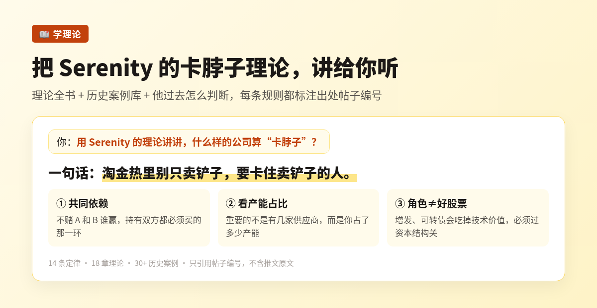
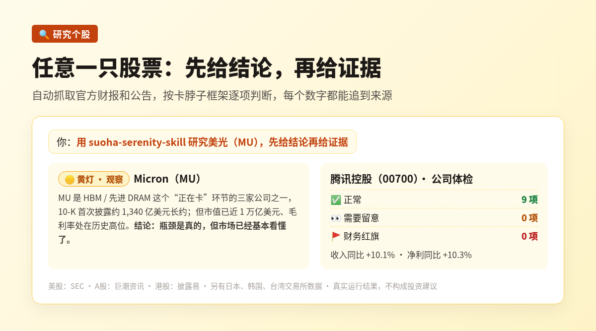

<p align="center"></p>

<p align="center">
  <a href="https://github.com/suoha888/suoha-serenity-skill/releases"></a>
  <a href="LICENSE"></a>
  
  <br>中文 | <a href="README.en.md">English</a>
</p>

**最完整的 Serenity 卡脖子理论研究 Skill**：A股、港股、美股任意一只股票，都能帮你研究供应链卡点、查官方财报、标出财务红旗。

## 它能帮你做什么

### 📖 学理论：把 Serenity 的卡脖子理论讲给你听

理论全书、历史案例库、他过去怎么判断，都整理好了。直接问，它按理论一步步讲。



### 🔍 研究个股：任意一只股票，先给结论再给证据

自动抓取官方财报和公告（美股 SEC、A股巨潮、港股披露易），按卡脖子框架逐项判断，标出财务红旗，每个数字都能追到来源。



## 直接对 AI 说

| 你说 | 你会得到 |
|---|---|
| 用 suoha-serenity-skill 讲讲 Serenity 的卡脖子理论 | 理论要点 + 历史案例 |
| 用 suoha-serenity-skill 体检 600519，先给结论再给证据 | 财务体检：哪里正常、哪里要留意、有没有红旗 |
| 用 suoha-serenity-skill 研究腾讯（00700）的供应链卡点 | 一份完整研究报告：结论、证据、风险 |
| 用 suoha-serenity-skill 看看 NVDA 有没有财务红旗 | 逐项检查结果，每项附公式 |

## 安装

需要 Git 和 Python 3.10+，**不需要任何 API Key**。

**① 复制一条命令安装**

macOS / Linux：

```bash
git clone https://github.com/suoha888/suoha-serenity-skill.git && cd suoha-serenity-skill && ./install.sh
```

Windows（PowerShell）：

```powershell
git clone https://github.com/suoha888/suoha-serenity-skill.git; cd suoha-serenity-skill; .\install.ps1
```

**② 在支持 Skills 的 AI 里直接说**（Claude Code、Codex 等），例如上面表格里的任意一句。

**③ 也可以在命令行试一只**：`python suoha.py check 600519`（不知道代码就用 `python suoha.py resolve 腾讯`）

Windows 被拦截或想手动安装，见 [使用手册 · 安装](docs/GUIDE.md#安装)。

## 为什么说“最完整”

| | 内容 |
|---|---|
| **理论** | 14 条定律、18 章理论、30+ 历史案例，每条标注出处帖子编号 |
| **数据** | 自动抓取官方数据：美股 SEC、A股巨潮、港股披露易，以及日本、韩国、台湾交易所 |
| **体检** | 按公司类型（银行、保险、券商、地产、一般企业）逐项检查，每项附公式和阈值 |
| **质量** | 190+ 自动测试，报告里的数字全部由脚本复算 |

## 更多

[使用手册](docs/GUIDE.md) · [常见问题](docs/FAQ.md) · [更新日志](docs/CHANGELOG.md) · [遇到问题点这里反馈](https://github.com/suoha888/suoha-serenity-skill/issues/new?template=field-test.yml)

## 作者与声明

由 **梭哈.AI**（[@suoha_AI](https://x.com/suoha_AI)）设计和维护。

研究方法提炼自 Serenity 公开发布的推文，只引用帖子编号，不含推文原文；报告由框架生成，不代表 Serenity 本人观点。本工具仅供研究，不构成投资建议。License：[MIT](LICENSE)。
