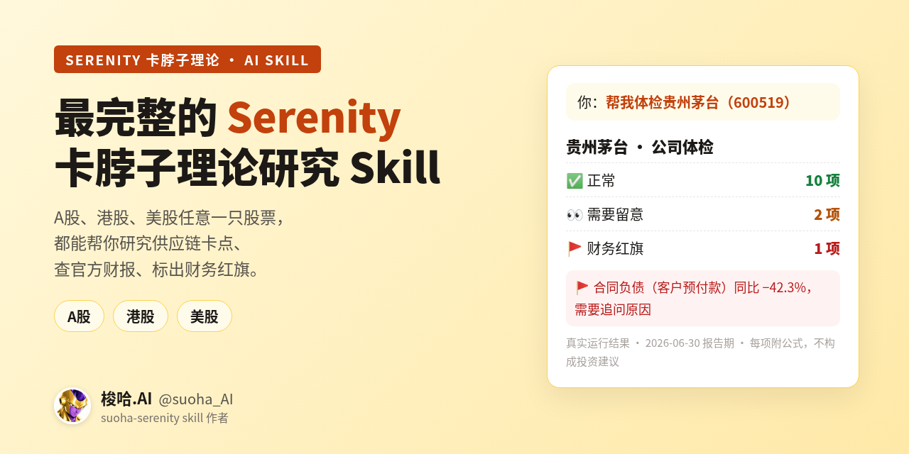
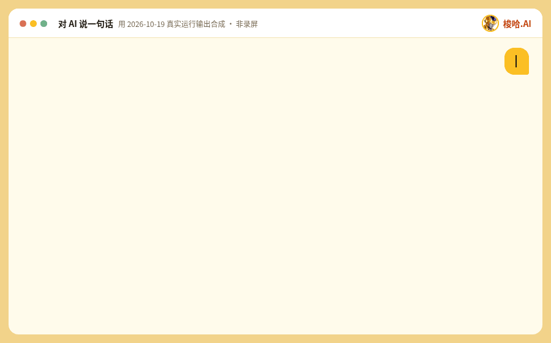
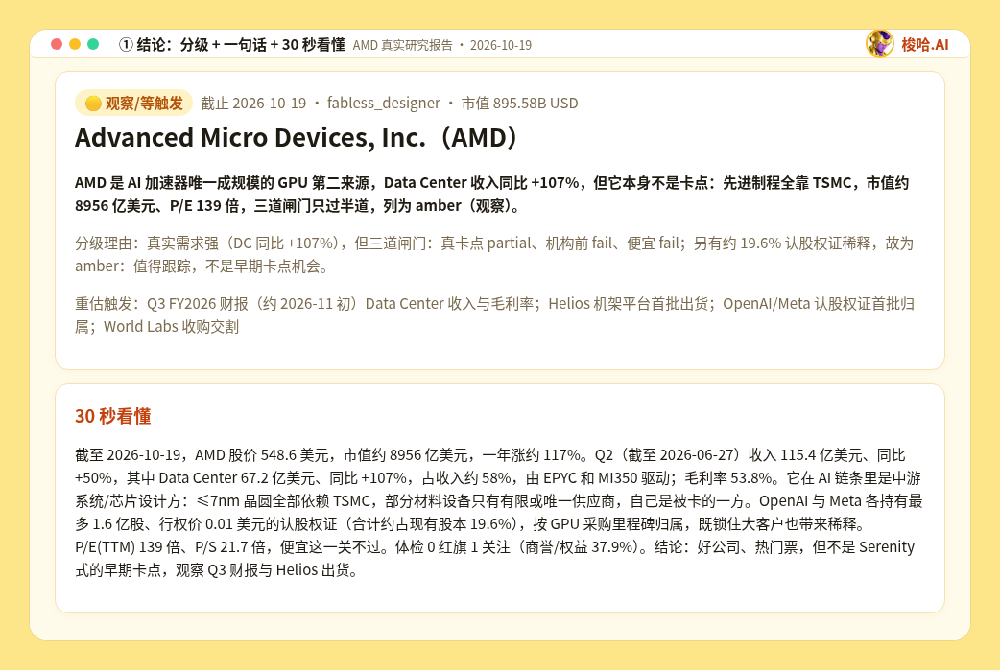
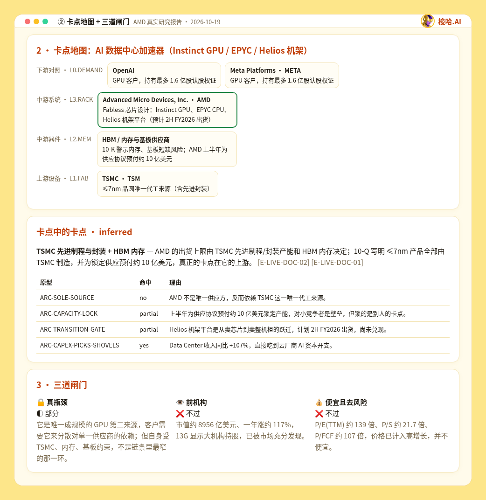
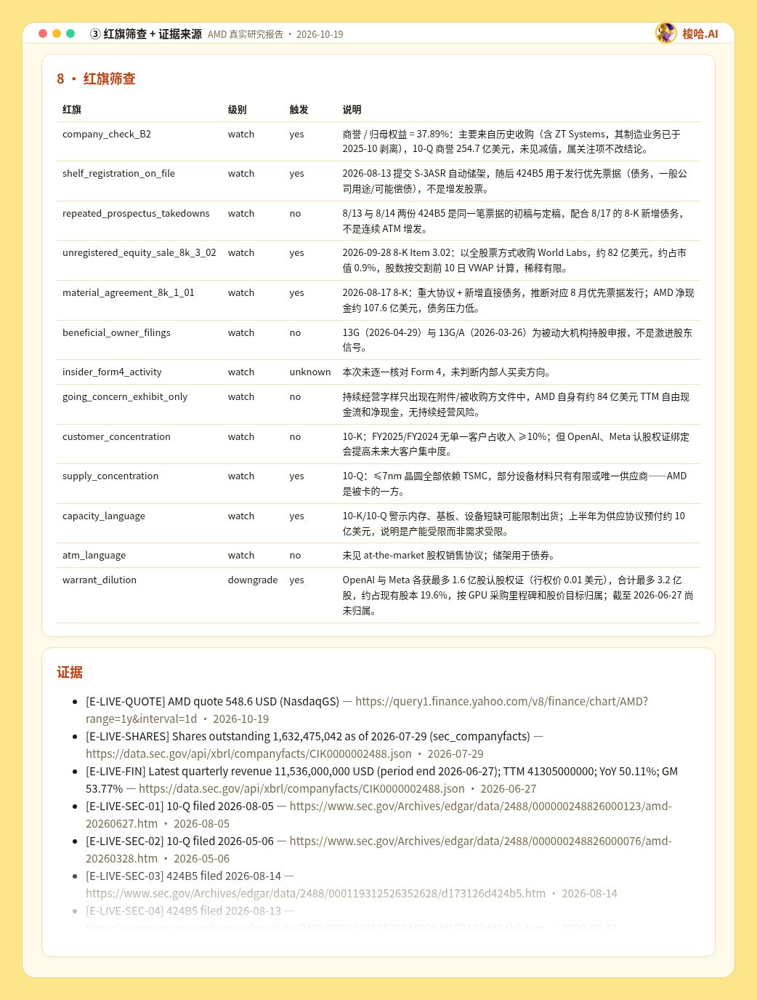

<p align="center"></p>

<p align="center">
  <a href="https://github.com/suoha888/suoha-serenity-skill/releases"></a>
  <a href="LICENSE"></a>
  
  <br>中文 | <a href="README.en.md">English</a>
</p>

**我把 Serenity 的研究方法做成了一个 AI Skill**：输入任意一只 A股、港股、美股代码，它会告诉你这家公司是不是真卡点、值不值得深挖、估值还有多少空间，以及出现什么情况说明看错了。

方法来自 Serenity（X：[@aleabitoreddit](https://x.com/aleabitoreddit)）：被粉丝称为“白毛股神”的独立 AI/半导体供应链研究员，在 X 上免费分享研究。想看原始思路，推荐直接关注 Serenity。

## 看一遍就懂：研究 AMD

<p align="center"></p>

<sub>动图用 2026-10-19 一次真实运行的输出合成（命令、数字和报告都是真的），不是某个 AI 客户端的录屏。</sub>

## 3 步开始用

**① 复制一条命令安装**（需要 Git 和 Python 3.10+，**不需要任何 API Key**）

macOS / Linux：

```bash
git clone https://github.com/suoha888/suoha-serenity-skill.git && cd suoha-serenity-skill && ./install.sh
```

Windows（PowerShell）：

```powershell
git clone https://github.com/suoha888/suoha-serenity-skill.git; cd suoha-serenity-skill; .\install.ps1
```

**② 打开支持 Skills 的 AI**（Claude Code、Codex 等）

**③ 直接说一句话**：`帮我研究股票：AMD（美股）`（如果 AI 没自动用上，就在前面加“用 suoha-serenity-skill”）

没装 Git：在本页点 **Code → Download ZIP**，解压后在该文件夹里运行 `./install.sh`（Windows 运行 `.\install.ps1`）。Windows 被拦截或想手动安装，见 [使用手册 · 安装](docs/GUIDE.md#安装)。

## 怎么用

| 你对 AI 说 | 你会得到 |
|---|---|
| 帮我研究股票：AMD（美股） | 一份完整研究报告：结论、卡点地图、三道闸门、红旗、证据 |
| 用 suoha-serenity-skill 体检 600519，先给结论再给证据 | 财务体检：哪里正常、哪里要留意、有没有红旗 |
| 用 suoha-serenity-skill 研究腾讯（00700）的供应链卡点 | 港股也一样：官方公告 + 卡点判断 |
| 用 suoha-serenity-skill 讲讲 Serenity 的卡脖子理论 | 理论要点 + 历史案例 |

也可以在命令行直接跑：

```bash
python suoha.py check 600519     # 财务体检（几秒出结果）
python suoha.py research AMD     # 抓取官方数据，生成研究包
python suoha.py timeline SIVE   # Serenity 公开言论档案（转述 + 帖子编号）
python suoha.py resolve 腾讯      # 不知道代码时先查代码
```

## 真实报告长这样（AMD，2026-10-19）

**① 结论先行：分级 + 一句话 + 30 秒看懂**



**② 卡点地图 + 三道闸门：它是不是真正的卡点**



**③ 红旗筛查 + 证据来源：每个数字都能追到官方文件**



完整报告：[examples/amd-serenity-report.html](examples/amd-serenity-report.html)（下载后用浏览器打开）· [Markdown 版](examples/amd-serenity-report.md)

## 它能做什么

- **研究个股**：自动抓取官方财报和公告（美股 SEC、A股巨潮、港股披露易，以及日本、韩国、台湾交易所），按卡脖子框架逐项判断，先给结论再给证据。
- **财务体检**：按公司类型（银行、保险、券商、地产、一般企业）逐项检查，每项附公式和阈值：✅ 正常、👀 留意、🚩 红旗。先判断公司处在哪个阶段（认证/放量期、周期高位、亏损不增长、常规经营），放量期不拿当期利润一票否决，改看现金跑道和融资方式；数据不足时明确提示，不会把“没数据”当成“没问题”。
- **学理论**：从 7,153 条公开推文提炼出 14 条定律、19 章理论（含“论点兑现与失效”）、35+ 历史案例和结果回看，另有 22 条他自己公开承认的判断错误或时机偏早（每条写清教训对应哪条规则），每条标注出处帖子编号。
- **公开言论档案**：每只股票他公开说过什么、立场什么时候变过、盯哪些 KPI、什么情况下会改变看法——全部是我们的中文转述 + 公开帖编号，不含原文，不含订阅内容。
- **卡点地图**：10 条产业链、46 个节点（含 AI 算力租赁、太空），输入股票代码即可看到它在链上的位置、上游和同层公司。
- **数字可复算**：报告里的数字全部由脚本复算，证据缺失或过期会被拦下；200+ 自动测试。

## 更多

[使用手册](docs/GUIDE.md) · [常见问题](docs/FAQ.md) · [更新日志](docs/CHANGELOG.md) · [遇到问题点这里反馈](https://github.com/suoha888/suoha-serenity-skill/issues/new?template=field-test.yml)

## 作者与声明

由 **梭哈.AI**（[@suoha_AI](https://x.com/suoha_AI)）设计和维护。

**方法来源：Serenity**（[@aleabitoreddit](https://x.com/aleabitoreddit)）
Serenity 被粉丝称为“白毛股神”，是一位独立的 AI/半导体供应链研究员，专注于挖掘供应链关键瓶颈，以及梳理超大规模厂商（hyperscaler）的供应链关系，在 X 平台免费分享研究。本项目的规则和案例都来自 Serenity 的公开帖子。仓库里只有我们的中文转述和帖子编号，原文请到 Serenity 的主页按编号查看。

本项目为非官方作品，与 Serenity 本人没有隶属或背书关系。研究方法提炼自 Serenity（@aleabitoreddit）公开发布的推文，只引用帖子编号，不含推文原文；报告由框架生成，不代表 Serenity 本人观点。本工具仅供研究，不构成投资建议。License：[MIT](LICENSE)。
